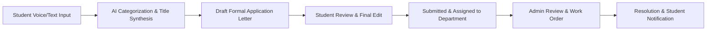

# ProofVoice — AI-Powered Multilingual Academic Grievance Management Platform

[](https://www.djangoproject.com/)
[](https://www.django-rest-framework.org/)
[](https://www.mysql.com/)
[](https://docs.gnani.ai/)
[](LICENSE)

> **"Your Voice. Your Campus. Your Solution."**  
> ProofVoice bridges the communication divide between university students and higher-education administrations. It empowers students to speak or type grievances in their native language, transforms informal input into formal applications addressed to university authorities, and coordinates multi-tenant departmental resolution workflows with complete transparency.

---

## Table of Contents

1. [Project Introduction](#1-project-introduction)
2. [Problem Statement](#2-problem-statement)
3. [Objectives](#3-objectives)
4. [Main Features](#4-main-features)
5. [Student Portal & Experience](#5-student-portal--experience)
6. [Administrator Workspace & Management](#6-administrator-workspace--management)
7. [End-to-End Complaint Lifecycle](#7-end-to-end-complaint-lifecycle)
8. [Voice-to-Text & Speech Technology](#8-voice-to-text--speech-technology)
9. [Gnani AI Integration](#9-gnani-ai-integration)
10. [Technology Stack](#10-technology-stack)
11. [Project Architecture & Directory Structure](#11-project-architecture--directory-structure)
12. [Installation & Local Setup](#12-installation--local-setup)
13. [Python Environment Setup](#13-python-environment-setup)
14. [Dependency Installation](#14-dependency-installation)
15. [MySQL Database Configuration](#15-mysql-database-configuration)
16. [Environment Variable Configuration](#16-environment-variable-configuration)
17. [Database Migrations & Seeding](#17-database-migrations--seeding)
18. [Running the Django Backend](#18-running-the-django-backend)
19. [Running the Frontend Application](#19-running-the-frontend-application)
20. [REST API Endpoint Reference](#20-rest-api-endpoint-reference)
21. [Automated & Manual Testing Guide](#21-automated--manual-testing-guide)
22. [Security Architecture & Guidelines](#22-security-architecture--guidelines)
23. [Interface Previews & Screenshots](#23-interface-previews--screenshots)
24. [Roadmap & Future Enhancements](#24-roadmap--future-enhancements)
25. [License & Acknowledgements](#25-license--acknowledgements)

---

## 1. Project Introduction

**ProofVoice** is an enterprise-grade academic grievance management system built on Django REST Framework and modern client web standards. Unlike generic issue ticketing software, ProofVoice is tailored specifically to university and college environments. It automates the generation of formal, institutional letters addressed to the Dean of Student Welfare, Warden, or Registrar, complete with verified enrollment identifiers, residential hall information, and departmental routing.

---

## 2. Problem Statement

Across campuses, students frequently face critical facility failures, hostel maintenance delays, sanitary issues, and academic disruptions. However:
- **Language and Formatting Barriers:** Many students hesitate to file complaints because drafting formal letters in English is tedious or intimidating.
- **Informal Loss of Track:** Complaints made via verbal requests or WhatsApp messages get lost without accountability.
- **Lack of Institutional Routing:** Students do not always know which administrative office handles a given issue.
- **Zero Visibility:** Once submitted, students have no visibility into work orders or estimated resolution dates.

---

## 3. Objectives

- **Democratize Campus Redressal:** Allow students to record grievances through spoken voice in Indian English, Hindi, or Marathi.
- **Automated Formal Application Drafting:** Convert informal problem descriptions into properly structured, professional academic letters.
- **Multi-Tenant Campus Isolation:** Securely serve multiple independent colleges, polytechnics, and universities from a single deployed platform.
- **Transparent Accountability:** Provide real-time complaint timelines, public administrative remarks, and status notifications.

---

## 4. Main Features

- 🎙️ **Multilingual Voice Grievances:** Real-time microphone audio capture with Web Audio API frequency visualizer.
- 🤖 **NLP-Powered Routing:** Automatic keyword classification routing tickets to Hostel Administration, Estate Maintenance, Sanitation, IT Services, or Academic Affairs.
- 📝 **Review-Before-Submit Flow:** Students preview and edit both the raw transcript and the generated formal letter before submission.
- 🆔 **Structured Identifiers:** Deterministic complaint tracking identifiers (e.g., `PV-2026-4563`).
- 🖼️ **Secure Profile Picture Management:** Photo uploads with deep PIL format verification, instant client preview, and topbar avatar synchronization.
- 🔔 **Instant Notification System:** In-app status updates with real-time badge clearing and read-state management.
- 📱 **Adaptive Responsive Design:** Fully optimized across compact mobile phones (320px+), tablets, and high-resolution monitors.

---

## 5. Student Portal & Experience

- **Student Dashboard:** Real-time metric cards displaying total grievances filed, pending desk reviews, active assignments, and verified resolutions.
- **Voice Record Button:** Prominent 96px touch-friendly microphone control with recording timer, audio playback preview, and discard options.
- **My Complaints Tracking Desk:** Searchable and filterable table displaying grievance subject, category, urgency, submission timestamp, and current state.
- **Complaint Details Timeline:** Step-by-step progress audit trail displaying administrative actions and technician remarks.
- **Student Profile:** Management of enrollment ID, enrolled department, academic year/semester, and residential hall address.

---

## 6. Administrator Workspace & Management

- **Institutional Grievance Desk:** Search, filter, and inspect tickets submitted across all campus departments.
- **Status & Work Order Dispatch:** Transition tickets across *Submitted*, *Under Review*, *Assigned*, *In Progress*, and *Resolved*.
- **Dual Remark Engine:** Supports public remarks (visible to students) and internal confidential notes (visible only to campus staff).
- **Campus User Directory:** Unified view of registered students and staff with institutional verification status.
- **Department Administration:** Add, configure, and manage institutional departments and grievance categories.

---

## 7. End-to-End Complaint Lifecycle



1. **Submission:** Student records audio or enters text description.
2. **Analysis:** System extracts core subject, suggests priority, and routes to the appropriate department.
3. **Drafting:** Formal letter generated addressed to the designated authority.
4. **Approval:** Student verifies credentials and clicks Submit.
5. **Action:** Institution Admin reviews ticket, dispatches technicians, and posts progress updates.
6. **Closure:** Grievance marked Resolved with verified completion details.

---

## 8. Voice-to-Text & Speech Technology

The voice recording workflow in `js/voice-recorder.js`:
- Uses the browser's `MediaRecorder` API (`audio/webm;codecs=opus` or `audio/wav`).
- Uses Web Audio API `AudioContext` and `AnalyserNode` to draw live frequency waveforms on an HTML5 canvas.
- Features an elapsed time counter (`MM:SS`), pause/resume controls, and an inline audio preview player.
- Sends recorded audio to the Django backend for server-side processing with Gnani AI Prisma STT.
- Automatically inserts transcribed text into the grievance description textarea without overwriting previously typed notes.

---

## 9. Gnani AI Integration

ProofVoice integrates with **Gnani AI** APIs via [`backend/apps/integrations/gnani_service.py`](backend/apps/integrations/gnani_service.py):

- **Prisma Speech-to-Text (`/stt/v3`):**  
  Endpoint: `https://api.vachana.ai/stt/v3`  
  Header: `X-API-Key-ID: <GNANI_API_KEY>`  
  Handles multipart audio uploads and returns transcripts for Indian English (`en-IN`), Hindi (`hi-IN`), and Marathi (`mr-IN`).
- **Timbre Text-to-Speech (`/api/v1/tts/inference`):**  
  Endpoint: `https://api.vachana.ai/api/v1/tts/inference`  
  Synthesizes speech to read aloud formal letters and administrative updates for accessibility.
- **Security & Privacy:**  
  API keys are maintained strictly in server-side environment variables and are **never** exposed to frontend JavaScript or client requests.

---

## 10. Technology Stack

- **Backend:** Python 3.12+ / 3.13, Django 6.0, Django REST Framework
- **Primary Database:** MySQL 8.0+ via `mysqlclient`
- **Security & Auth:** DRF Token Authentication, PBKDF2 Password Hashing, CORS Headers
- **Image Processing:** Pillow (PIL)
- **Frontend:** Semantic HTML5, CSS3 (Custom Design System, CSS Variables, Responsive Grid), Vanilla JavaScript (ES6+)
- **AI/Speech:** Gnani AI Prisma STT & Timbre TTS, Custom Rule-Based NLP Pipeline

---

## 11. Project Architecture & Directory Structure

```
ProofVoice/
├── index.html                   # Landing page with feature highlights & role portals
├── login.html                   # Unified authentication login
├── register.html                # Student registration form
├── institution-register.html    # College/University onboarding portal
├── student-dashboard.html       # Student overview metrics & recent filings
├── student-profile.html         # Student profile & letter settings
├── new-complaint.html           # Complaint submission & microphone recorder
├── review-complaint.html        # Formal application review & sign-off
├── my-complaints.html           # Student tracking list
├── complaint-details.html       # Student audit timeline view
├── student-notifications.html   # Student alert desk
├── admin-dashboard.html         # Administrator dashboard & facility metrics
├── admin-complaints.html        # Institutional complaint management desk
├── admin-complaint-details.html # Administrator ticket review & dispatch
├── admin-profile.html           # Administrator profile & credentials
├── admin-notifications.html     # Administrative alert log
├── departments.html             # Department and category configuration
├── users.html                   # Campus user directory
├── analytics.html               # Institutional reporting & resolution charts
├── css/                         # Modular CSS stylesheets (variables, components, responsive)
├── js/                          # Frontend controllers (app.js, api-client.js, voice-recorder.js)
├── backend/
│   ├── manage.py                # Django management entry point
│   ├── requirements.txt         # Backend Python dependencies
│   ├── .env.example             # Environment template (safe for public repository)
│   ├── init_db.sql              # MySQL initialization script
│   ├── config/                  # Settings, URLs, WSGI, ASGI
│   ├── apps/
│   │   ├── accounts/            # User model, student & admin profiles, photo uploads
│   │   ├── institutions/        # Multi-tenant institutions & departments
│   │   ├── complaints/          # Complaint model, status history, letter generator
│   │   ├── notifications/       # User notifications
│   │   ├── integrations/        # Gnani AI Prisma & Timbre client, AI NLP engine
│   │   └── analytics/           # Metric aggregations
│   └── tests/                   # Automated unit and integration test suite
├── requirements.txt             # Root Python requirements
└── README.md                    # Project documentation
```

---

## 12. Installation & Local Setup

### Prerequisites
- Python 3.12 or 3.13
- MySQL Server 8.0+ (running locally on port 3306)
- Node.js (v18+) or any static HTTP server (e.g. Python `http.server`)

---

## 13. Python Environment Setup

Clone the repository and set up a Python virtual environment:

```powershell
# Navigate to project root
cd C:\Users\RAJ\OneDrive\Desktop\ProofVoice

# Create virtual environment
python -m venv venv

# Activate on Windows PowerShell
.\venv\Scripts\Activate.ps1
```
*(On Linux/macOS: `source venv/bin/activate`)*

---

## 14. Dependency Installation

Install all required packages:

```powershell
pip install -r requirements.txt
```

---

## 15. MySQL Database Configuration

1. Log in to MySQL as `root` and run the initialization script:

```powershell
mysql -u root -p < backend\init_db.sql
```

2. Alternatively, create the database manually:

```sql
CREATE DATABASE IF NOT EXISTS proofvoice_db CHARACTER SET utf8mb4 COLLATE utf8mb4_unicode_ci;
CREATE USER IF NOT EXISTS 'proofvoice_user'@'127.0.0.1' IDENTIFIED BY 'your_secure_password';
GRANT ALL PRIVILEGES ON proofvoice_db.* TO 'proofvoice_user'@'127.0.0.1';
FLUSH PRIVILEGES;
```

---

## 16. Environment Variable Configuration

Create your local `.env` file from the provided template:

```powershell
Copy-Item backend\.env.example backend\.env
```

Edit `backend\.env` with your local settings:

```ini
DJANGO_SECRET_KEY=generate-a-strong-secret-key-for-local-development
DJANGO_DEBUG=True
DJANGO_ALLOWED_HOSTS=localhost,127.0.0.1

DB_ENGINE=django.db.backends.mysql
DB_NAME=proofvoice_db
DB_USER=proofvoice_user
DB_PASSWORD=your_secure_password
DB_HOST=127.0.0.1
DB_PORT=3306

FRONTEND_ORIGIN=http://localhost:3000,http://127.0.0.1:3000

# Gnani AI API Key (Optional: Leave blank for demo mode)
GNANI_API_KEY=your_gnani_api_key_here
GNANI_API_BASE_URL=https://api.vachana.ai

MAX_UPLOAD_SIZE_MB=5
```

---

## 17. Database Migrations & Seeding

Apply database migrations:

```powershell
python backend\manage.py migrate
```

Seed initial institutions, departments, and demo accounts:

```powershell
python backend\manage.py seed_demo_data
```

---

## 18. Running the Django Backend

Start the development server:

```powershell
python backend\manage.py runserver 127.0.0.1:8000
```

The REST API will be available at: `http://127.0.0.1:8000/api/v1/`

---

## 19. Running the Frontend Application

In a separate terminal, serve the frontend static files locally:

```powershell
# Using npx serve (recommended)
npx serve -l 3000

# Or using Python's built-in HTTP server
python -m http.server 3000
```

Open your browser at **`http://localhost:3000/`**.

---

## 19.1. Production Cloud Deployment Architecture

ProofVoice is architected for decoupled cloud deployment:

```
┌───────────────────────────────────────┐
│     Vercel (Production Frontend)      │
│     https://proofvoice.vercel.app     │
│   (HTML5, Modern CSS, Client-side JS) │
└───────────────────┬───────────────────┘
                    │ HTTPS REST APIs
                    ▼
┌───────────────────────────────────────┐
│     Render (Production Backend)       │
│      Django REST Framework + WSGI     │
│  (Gnani AI STT/TTS & LLM Integrations)│
└───────────────────┬───────────────────┘
                    │ TCP / SSL
                    ▼
┌───────────────────────────────────────┐
│       Cloud MySQL 8.0+ Database       │
│  (Persistent Multi-Tenant Isolation)  │
└───────────────────────────────────────┘
```

1. **Frontend Hosting (Vercel):**
   - Pure static deployment governed by `vercel.json` (static build override, clean URLs) and `.vercelignore` (excludes backend dependencies and requirements from Vercel's build pipeline).
   - Configurable API base endpoint in `js/api-client.js` supporting both local development (`http://127.0.0.1:8000/api/v1`) and HTTPS production backends.

2. **Backend Services (Render / Cloud Container):**
   - Django REST Framework 3.15+ on Python 3.13 with Gunicorn.
   - Enforces institutional multi-tenancy, token authentication, and Gnani AI audio proxies.

3. **Database Tier (Cloud MySQL):**
   - MySQL 8.0+ engine supporting UTF-8 (mb4) for multilingual grievance filings.

4. **Institutional Onboarding & Verification:**
   - Supports verified institutions as well as an unlisted institution request workflow (`+ My Institution Is Not Listed`).
   - Automatically registers pending institutions and applicant requests for Platform Superadmin review without premature workspace activation.

5. **Profile Photo Management:**
   - Multi-format support (JPG, JPEG, PNG, WebP, max 5 MB).
   - Server-side verification via Pillow prevents malicious binary uploads.


---

## 20. REST API Endpoint Reference

| Method | Endpoint | Access | Description |
| :--- | :--- | :---: | :--- |
| `POST` | `/api/v1/auth/login/` | Public | Authenticates user; returns auth token & role |
| `POST` | `/api/v1/auth/register/student/` | Public | Registers student profile with enrollment details |
| `GET` | `/api/v1/auth/me/` | Authenticated | Fetches current user profile |
| `POST` | `/api/v1/auth/profile/photo/` | Authenticated | Uploads profile photo with PIL verification |
| `DELETE` | `/api/v1/auth/profile/photo/` | Authenticated | Removes current user profile picture |
| `GET` | `/api/v1/institutions/` | Public | Lists verified educational institutions |
| `GET` | `/api/v1/complaints/` | Authenticated | Lists grievances filed by current student |
| `POST` | `/api/v1/complaints/` | Authenticated | Submits new grievance |
| `GET` | `/api/v1/complaints/<id>/` | Authenticated | Fetches complaint details (tenant-isolated) |
| `POST` | `/api/v1/complaints/generate-application/` | Authenticated | Previews formal Dean application letter |
| `GET` | `/api/v1/admin/complaints/` | Admin Only | Lists institution complaints |
| `POST` | `/api/v1/admin/complaints/<id>/status/` | Admin Only | Updates status, public remarks & internal notes |
| `GET` | `/api/v1/notifications/` | Authenticated | Retrieves user notifications |
| `POST` | `/api/v1/ai/stt/` | Authenticated | Transcribes voice audio via Gnani AI Prisma STT |
| `POST` | `/api/v1/ai/tts/` | Authenticated | Converts text to speech via Gnani AI Timbre TTS |
| `POST` | `/api/v1/ai/process/` | Authenticated | AI structuring, categorization & tone refinement |

---

## 21. Automated & Manual Testing Guide

Run the automated test suite:

```powershell
$env:USE_SQLITE_FOR_TESTS="True"
python backend\manage.py test tests
```

### Manual QA Checklist
1. **Student Registration:** Sign up with university email, select institution, verify profile completion.
2. **Voice Recording:** Click *Record Complaint*, grant mic access, speak issue in selected language, verify transcript.
3. **Formal Letter:** Click *Generate Formal Application*, verify Dean salutation, address, and student ID formatting.
4. **Admin Resolution:** Log in as administrator, update status to *In Progress*, add remark, verify student notification.
5. **Profile Photo:** Upload JPG/PNG image, verify topbar avatar updates, test photo removal.

---

## 22. Security Architecture & Guidelines

- **Zero Hardcoded Secrets:** All credentials, database passwords, and API keys are read via environment variables.
- **Tenant Isolation:** Enforced strictly in Django queries. Cross-institution access attempts return `HTTP 403 Forbidden`.
- **Upload Inspection:** Uploaded files undergo MIME, extension, file size, and PIL deep image verification.
- **CSRF & CORS:** Cross-Origin requests are restricted to configured client origins.
- **Git Exclusions:** The root `.gitignore` excludes `.env`, `media/`, `*.sqlite3`, and temporary caches.

---

## 23. Interface Previews & Screenshots

| View | Description |
| :--- | :--- |
| **Student Portal** | Grievance metrics, microphone recorder, and active complaint tracking. |
| **Voice Visualizer** | Real-time canvas frequency waveforms and audio playback controls. |
| **Formal Letter Preview** | Side-by-side comparison of raw student input and generated Dean letter. |
| **Admin Workspace** | Institutional complaints desk with status management and technician work orders. |
| **Profile Settings** | Profile photo upload, instant preview, and academic credentials management. |

---

## 24. Roadmap & Future Enhancements

- 📱 Progressive Web App (PWA) offline grievance drafting
- 📊 Predictive analytics on recurring campus equipment failure hotspots
- 📧 Automated email dispatch of formal letters directly to institutional mail servers
- 🔐 Single Sign-On (SSO) integration via Google Workspace for Education and SAML 2.0

---

## 25. License & Acknowledgements

This project is licensed under the **MIT License**.  
Developed for the **Great Indian AI Internship Challenge** powered by **Gnani AI**.

Special thanks to the **Gnani AI** team for speech recognition and language technology APIs.
